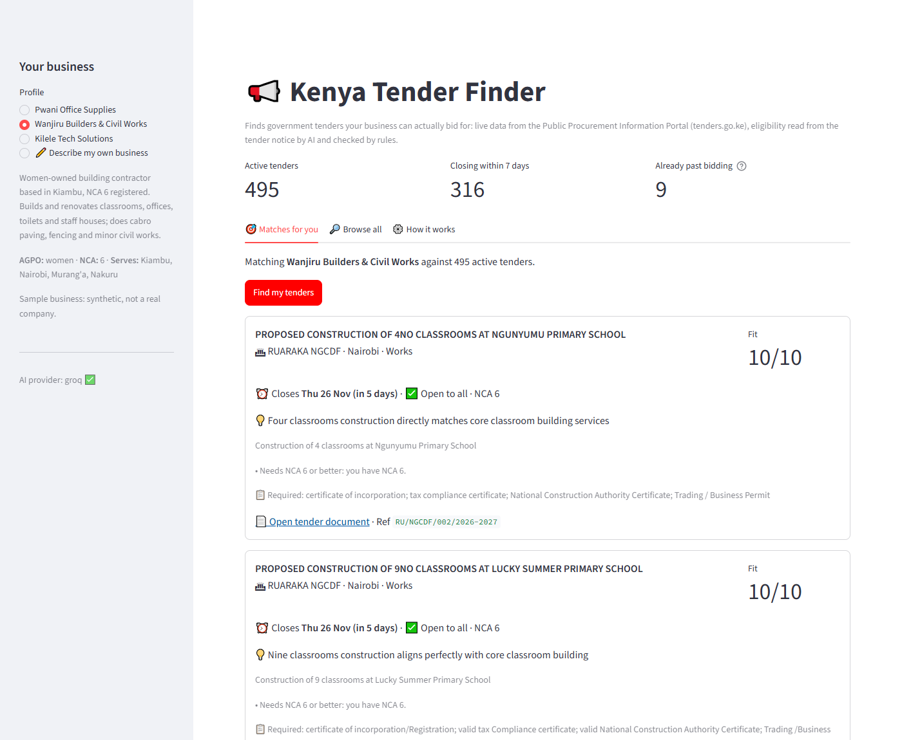

# 📢 Kenya Tender Finder

**An AI agent that reads Kenya's government tender notices and tells a small business which ones it can actually bid for.**

**[▶ Try the live demo](https://kenya-tender-finder.streamlit.app/)**: pick a sample business or describe your own, then click *Find my tenders*. *(If the app has been asleep it takes ~30 s to wake up.)*

Kenya publishes around 500 active government tenders at any time on the [Public Procurement Information Portal](https://tenders.go.ke). Small businesses miss most of them. The listing shows only a title and a deadline. The details that decide whether you can bid (*reserved for youth? NCA 6 or better? KES 500,000 bid security?*) are buried in PDF notices. And most tenders close within a week of being posted (316 of 495 on the day I measured).

This agent fetches every active tender, reads the notices with an LLM, **checks eligibility with plain rules**, ranks the fit, and shows the matches with a reason for each. Optionally, it can send new matches to Telegram every morning.



## What it does
- **Live data, not scraping guesswork:** it uses the portal's public JSON feed. A one-request-per-second fetch takes about 5 seconds.
- **Reads messy PDF notices:** the LLM fills a fixed schema (AGPO reservation, NCA category, bid security, required documents, site visit). It handles notices that list ten tenders in one table and tables whose columns are interleaved.
- **Eligibility is decided by code, not by the AI:** youth/women/PWD reservations, NCA grade ("NCA 6 and above") and bid security are checked against your profile in Python.
- **Can't invent eligibility:** every reservation claim must quote the notice, and the code checks that the quote is really in the PDF. If it isn't, the claim is discarded.
- **Catches stale listings:** tenders still marked "active" but with award or evaluation documents attached are dropped.
- **Optional daily alerts:** a GitHub Actions job can send new matches to your own Telegram bot (off by default; see below).

## Architecture
```
tenders.go.ke API ─► fetch_tenders ─► SQLite (allow-listed fields only)
                                            │
                profile.yaml ──► match ─────┤ 1. rules: deadline, category, county, past-bidding
                                            │ 2. BM25 keyword prefilter ─► top 25 only
             notice PDF ─► extract_notice ──┤ 3. LLM → JSON → validated + quote-grounded (cached)
                                            │ 4. eligibility rules: AGPO group, NCA grade, bid security
                                            │ 5. LLM fit score 0–10 + one-line reason (one batched call)
                                            ▼
                         Streamlit app   ·   digest ─► Telegram (optional, GitHub Actions)
```

**Designed for a free tier.** Deterministic filters cut ~500 tenders to 25 before any AI call. Extractions are cached by document URL, so after the first day only new tenders cost tokens, typically fewer than 15 calls a day. Downloads run 6 at a time because the portal can be slow.

**Fast for visitors.** Reading ~25 PDFs from a slow government server takes minutes, so a scheduled job (`.github/workflows/warm_cache.yml`) pre-reads the notices for the sample businesses every morning and publishes them as one small JSON file on the `cache` branch. The app loads that file when it starts, then quietly reads anything still missing in a background thread. A visitor's search mostly hits the cache.

## Does the extraction work? (evaluation)
I hand-labelled 18 real notices from the PDF text, without looking at the model's answers. The labels include multi-tender tables, scanned-then-fallback documents and the traps listed below. `python -m evals.extraction_eval` re-runs the real pipeline against them:

| Field | Correct | Accuracy |
|---|---|---|
| AGPO reservation (`reserved_for`) | 16 / 18 | 89% |
| NCA category | 18 / 18 | 100% |
| Bid security (KES) | 17 / 17 | 100% |

*One label skipped: that tender has a different bid security for each lot.*

**Both misses err on the safe side.** In one constituency's notice format, the word "OPEN" lands in the middle of the tender title when the PDF table is flattened to text, cut off from its "Eligibility" header. The model answers *unknown* instead of guessing. An unknown tender is still shown to the user, flagged "Reservation not stated: check the notice", so nothing eligible is hidden. I chose not to tune the prompt to this one format, to avoid overfitting to the eval set.

Traps the eval covers: "WOMEN CATEGORY-12" is a pre-qualification category, not an NCA grade. "Tender security of 2%" is not a KES amount. "Reserved Monday 30th for Women" is a table row split across columns. And some documents state nothing at all, where the right answer is *unknown*, not a guess.

## Privacy
The portal's API response also contains **personal data about procurement officers** (national ID numbers, phone numbers, personal emails, account tokens). This project keeps only an explicit allow-list of tender fields and never stores or prints the rest. A test feeds in a synthetic record with fake personal data and fails if any of it survives. All test fixtures and sample business profiles are synthetic.

## Quick start
```bash
py -m venv .venv
.venv/Scripts/python -m pip install -r requirements.txt
copy .env.example .env          # add a free GROQ_API_KEY from console.groq.com
.venv/Scripts/python -m streamlit run app.py
```
CLI:
```bash
python -m tools.fetch_tenders                                   # fetch & store active tenders
python -m tools.match profiles/women_contractor_kiambu.yaml     # ranked matches with reasons
python -m tools.run_daily --dry-run                             # full daily run, print instead of send
python -m pytest                                                # offline tests (no network, no LLM)
python -m evals.extraction_eval                                 # accuracy on hand-labelled notices
```

## Optional: daily Telegram alerts (free)
1. In Telegram, message **@BotFather**, send `/newbot` and copy the token into `TELEGRAM_BOT_TOKEN`.
2. Send any message to your new bot, then run `python -m tools.telegram` to get your chat ID and put it in `TELEGRAM_CHAT_ID`.
3. For daily alerts, fork the repo, add `GROQ_API_KEY`, `TELEGRAM_BOT_TOKEN` and `TELEGRAM_CHAT_ID` as **Actions secrets**, and uncomment the `schedule:` lines in `.github/workflows/daily.yml` (it runs only on demand by default).

Add your own business as a YAML file in `profiles/` (copy one of the three samples).

## Project layout
```
tools/       fetch_tenders · store · extract_notice · match · digest · telegram · run_daily · warm_cache · llm
profiles/    three synthetic sample businesses (youth ICT supplier, women NCA 6 contractor, coast stationery supplier)
evals/       hand-labelled notices + accuracy script
workflows/   the operating procedure, including every data quirk found while building
app.py       Streamlit UI
```

## Limits
- Scanned notices without a text layer are skipped (the tool tries the next document). There's no OCR, to stay free and light.
- Only the first 3 pages of a document are read. Rare requirements buried deeper won't be seen.
- **Always confirm requirements in the official tender document before bidding.** This tool is a filter, not legal advice.

## Stack
Python · pdfplumber · SQLite · Groq (`gpt-oss-120b`, free tier) or Ollama · Streamlit · GitHub Actions · Telegram Bot API
